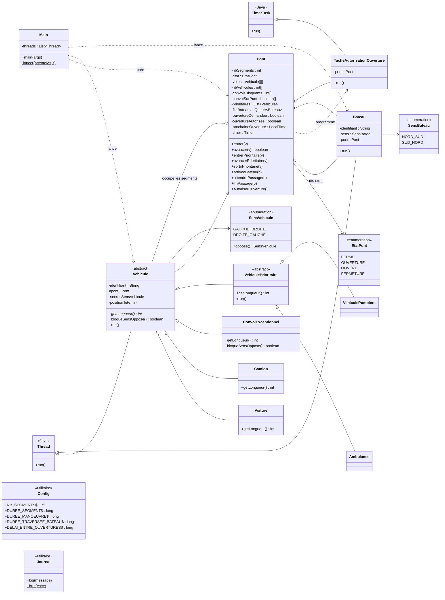

# Schéma UML des classes

Le diagramme ci-dessous est affiché automatiquement par GitHub (syntaxe Mermaid).

## Rôle des classes

| Classe | Rôle |
|---|---|
| `Main` | Crée le pont et lance le scénario de démonstration (threads décalés dans le temps). |
| `Config` | Regroupe les paramètres (nombre de segments, durées, délai d'une minute). |
| `Journal` | Affichage synchronisé des messages dans la console. |
| `Pont` | **Moniteur** central : états du pont, segments, convois, prioritaires, file FIFO des bateaux, ouvertures/fermetures. Toutes les attentes se font avec `synchronized` / `wait()` / `notifyAll()`. |
| `TacheAutorisationOuverture` | `TimerTask` lancée une minute après chaque fermeture complète ; autorise l'ouverture suivante et la déclenche si des bateaux attendent. |
| `Vehicule` | Thread de base d'un véhicule : entrer, avancer segment par segment, sortir. |
| `Voiture` / `Camion` / `ConvoiExceptionnel` | Occupent 1 / 2 / 4 segments. Le convoi bloque le sens opposé. |
| `VehiculePrioritaire` | Thread d'un véhicule prioritaire : les véhicules de son sens s'arrêtent sur la bande d'urgence. |
| `Ambulance` / `VehiculePompiers` | Les deux types de véhicules prioritaires. |
| `Bateau` | Thread d'un bateau : file FIFO, attente de l'ouverture complète, traversée. |
